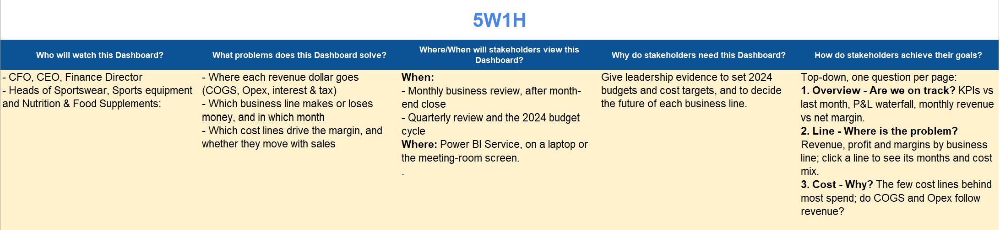
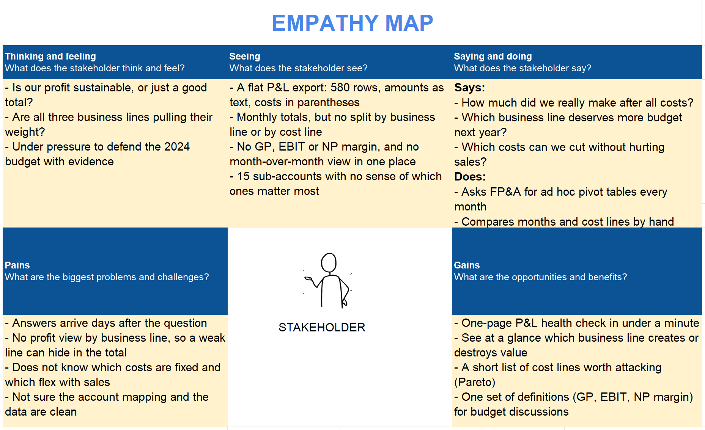
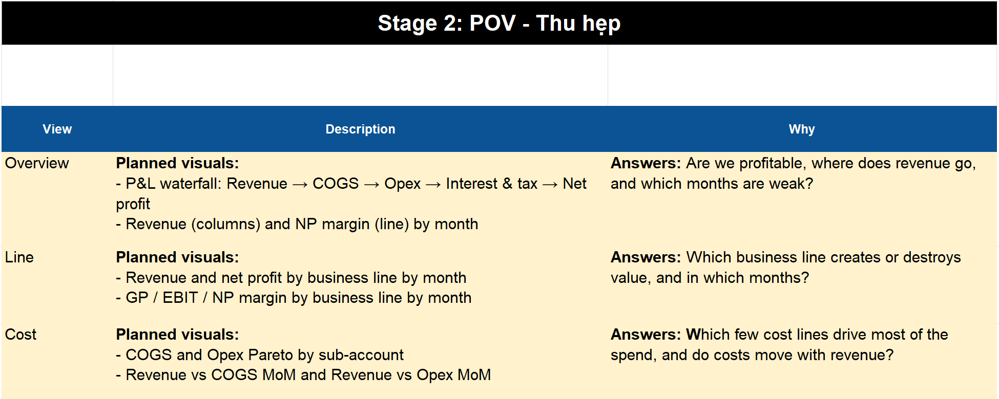
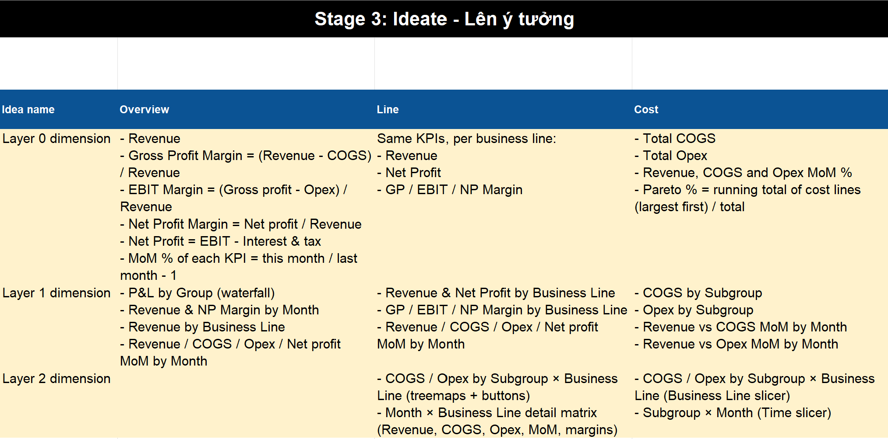
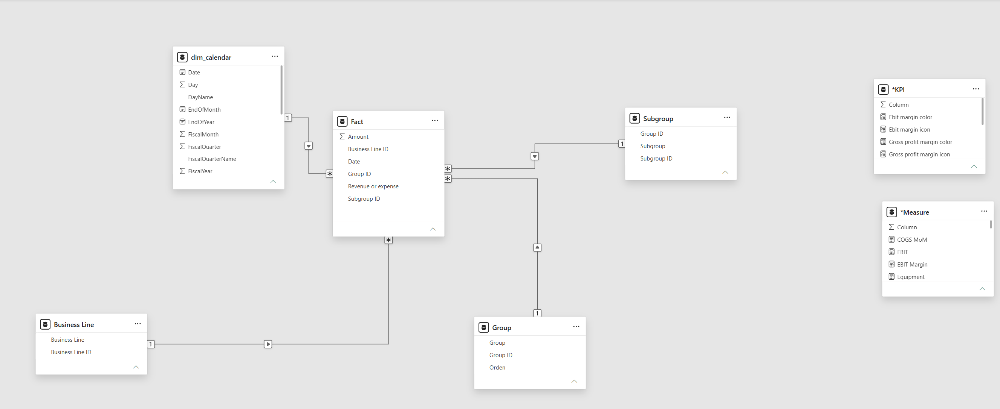
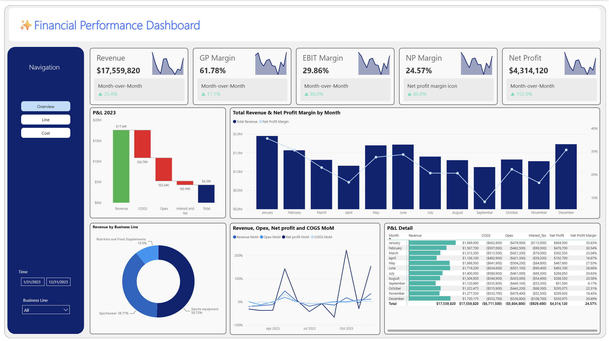
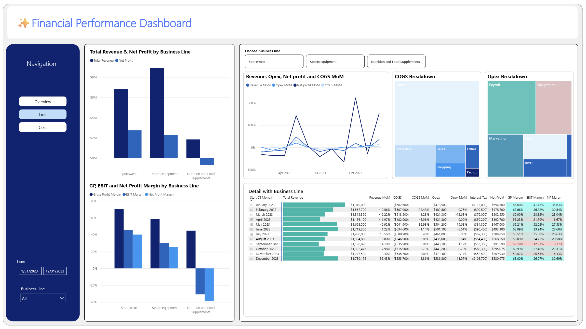
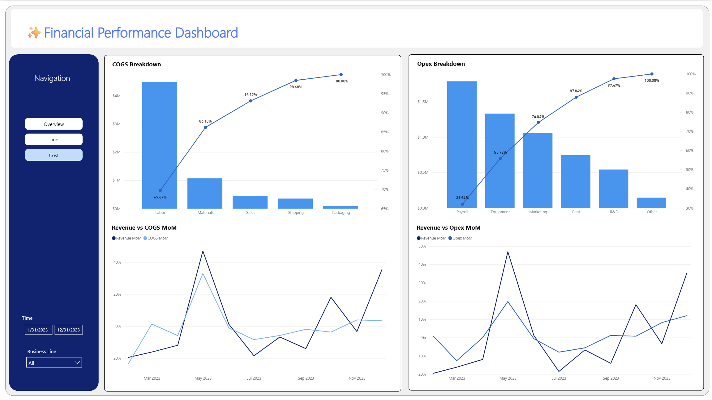

# [POWER BI] Analyze the 2023 Financial Performance of a Sports Company to Guide the 2024 Budget

## 1. Objective

### 1.1. What is this project about?

This project builds a 3-page Power BI dashboard from the 2023 profit and loss (P&L) data of a sports company with three business lines: Sportswear, Sports equipment, and Nutrition & Food Supplements. The raw data is a simple table of 580 monthly P&L records. The dashboard turns it into one clear P&L view, from revenue down to net profit, by month and by business line. Users can also look deeper into the costs behind the margins.

The work followed three steps:

1. Brainstorm with the Design Thinking canvas (Excel) before working with the data: who will use the dashboard, what they need, which questions it must answer and which charts belong on each page.
2. Build the dashboard in Power BI based on that plan.
3. Analyse the dashboard and turn the findings into recommendations.

### 1.2. Who is this project for?

- **CFO / Finance Director (main user):** responsible for the P&L and the 2024 budget, and needs one place to see profit, margin trends and the main costs.
- **CEO / Board:** decides which business line to grow, fix or close.
- **Heads of the three business lines:** responsible for their own revenue and cost targets, and want to compare their line with the others.
- **FP&A / cost controllers:** compare each month's results with the plan.

### 1.3. Business Questions

1. How much profit do we make, and where does each dollar of revenue go?
2. Which months perform poorly, and why?
3. Which business line makes money, and which loses money?
4. Which costs matter most, and do they change with revenue or stay the same?

### 1.4. Project Outcome

- **A 3-page interactive dashboard:**
  - Overview: are we on track?
  - Line: where is the problem?
  - Cost: why?
- **Answers to the four questions:**
  1. 2023 was profitable: \$17.56M revenue, \$4.31M net profit, a 24.6% net margin.
  2. Profit depends heavily on sales. In the weakest month, September, the net margin was only 8.2%, compared with 35.6% in January.
  3. Sportswear earns 63% of group profit from 39% of revenue. Nutrition & Food Supplements lost \$0.71M.
  4. People costs (Labor + Payroll) are half of all costs, and most costs barely go down when revenue falls.
 
## 2. Design Thinking Process

The canvas was filled in before the dashboard was built. It only shows what was known at that time: the users, their needs, the structure of the raw data, the questions to answer, and the planned pages and metrics. The results come later, in sections 4 and 5.

### Stage 1: Empathize

**5W1H**

| Question | Answer |
|---|---|
| **Who** will use the dashboard? | • CFO / Finance Director and CEO • Heads of Sportswear, Sports equipment and Nutrition & Food Supplements |
| **What** problems does it solve? | • Where each revenue dollar goes (COGS, Opex, interest & tax) • Which business line makes or loses money, and in which month • Which cost lines drive the margin, and whether they move with sales |
| **When / Where** will they use it? | • **When:** the monthly business review after month-end close, the quarterly review and the 2024 budget cycle • **Where:** Power BI Service, on a laptop or the meeting-room screen |
| **Why** do they need it? | To have evidence for setting the 2024 budget and cost targets, and for deciding the future of each business line |
| **How** do they reach their goals? | Top-down, one question per page: 1. **Overview – Are we on track?** KPIs vs last month, P&L waterfall, monthly revenue vs net margin 2. **Line – Where is the problem?** Revenue, profit and margins by business line; click a line to see its months and cost mix 3. **Cost – Why?** The few cost lines behind most of the spending, and whether COGS and Opex follow revenue |

**Empathy Map** (persona: CFO / Finance Director, before the dashboard exists)

| Thinking & feeling | Seeing | Saying & doing |
|---|---|---|
| • Is our profit sustainable, or just a good total? • Are all three business lines making enough money? • Under pressure to defend the 2024 budget with evidence | • A long P&L export: 580 rows, amounts stored as text, costs in parentheses • Monthly totals, but no split by business line or by cost line • No GP, EBIT or NP margin, and no month-over-month view in one place • 15 sub-accounts, with no sense of which ones matter most | **Says:** • How much did we really make after all costs? • Which business line deserves more budget next year? • Which costs can we cut without hurting sales? **Does:** • Asks FP&A for new Excel reports every month • Compares months and cost lines by hand |

| Pains | Gains |
|---|---|
| • Answers arrive days after the question • No profit view by business line, so a weak line can hide in the total • Does not know which costs are fixed and which change with sales • Not sure the account mapping and the data are clean | • A one-page P&L check in under a minute • See at a glance which business line makes or loses money • A short list of cost lines worth cutting (Pareto) • One set of definitions (GP, EBIT, NP margin) for budget discussions |

### Stage 2: POV

One main question per page.

| Page | Planned visuals | Business question it answers |
|---|---|---|
| **Overview** | • P&L waterfall: Revenue → COGS → Opex → Interest & tax → Net profit • Revenue (columns) and NP margin (line) by month | Are we profitable, where does revenue go, and which months are weak? |
| **Line** | • Revenue and net profit by business line, by month • GP / EBIT / NP margin by business line, by month | Which business line makes or loses money, and in which months? |
| **Cost** | • COGS and Opex Pareto by sub-account • Revenue vs COGS MoM and Revenue vs Opex MoM | Which few cost lines drive most of the spending, and do costs move with revenue? |

### Stage 3: Ideate

The metrics planned for each page, from the main KPIs (Layer 0) to more detailed breakdowns (Layers 1 and 2).

| Layer | Overview | Line | Cost |
|---|---|---|---|
| **Layer 0** Main KPIs | • Revenue • Gross Profit Margin = (Revenue − COGS) / Revenue • EBIT Margin = (Gross profit − Opex) / Revenue • Net Profit Margin = Net profit / Revenue • Net Profit = EBIT − Interest & tax • MoM % = this month / last month − 1 | Same KPIs for each business line: • Revenue • Net Profit • GP / EBIT / NP Margin | • Total COGS • Total Opex • Revenue, COGS and Opex MoM % • Pareto % = running total of cost lines (largest first) / total |
| **Layer 1** Split by one dimension | • P&L by Group (waterfall) • Revenue & NP Margin by Month • Revenue by Business Line • Revenue / COGS / Opex / Net profit MoM by Month | • Revenue & Net Profit by Business Line • GP / EBIT / NP Margin by Business Line • Revenue / COGS / Opex / Net profit MoM by Month | • COGS by Subgroup • Opex by Subgroup • Revenue vs COGS MoM by Month • Revenue vs Opex MoM by Month |
| **Layer 2** Split by two dimensions | • P&L detail table: Month × P&L line | • COGS / Opex by Subgroup × Business Line (treemaps + buttons) • Month × Business Line detail matrix (Revenue, COGS, Opex, MoM, margins) | • COGS / Opex by Subgroup × Business Line (Business Line slicer) • Subgroup × Month (Time slicer) |

View the original Excel canvas

## 3. Data Modeling

The raw CSV files were loaded into Power BI, cleaned in Power Query and organised as a star schema (one fact table linked to several dimension tables).

## 4. Key Insights & Visualizations

All figures are for 2023, in USD, as recorded in the source data.

### 4.1. Overview: Are we on track?

- **The company is profitable, but its profit depends heavily on keeping sales high.**
  - Overheads (Opex) are almost as large as the cost of the products (COGS). For a company that sells physical goods this is unusual. It means a large part of the costs (staff, equipment, rent) must be paid every month, whatever the sales.
  - As a result, a 10% fall in sales would wipe out roughly a quarter of the year's profit.
- **Weak months are a cost problem, not only a sales problem.**
  - When sales fell, costs stayed almost the same. From January to September, about 73¢ of every lost sales dollar came straight out of profit; from August to September, almost all of it did.
  - October's +222% jump in profit was only a bounce back to August's level, not a real recovery.
- **The second-half slowdown came mostly from consulting, not from sports products.**
  - Product sales follow the usual sporting-goods calendar (New Year fitness, summer, holiday gifts) and fell only slightly in the second half.
  - Consulting is only about 16% of revenue but caused more than half of the H2 drop. It depends on winning contracts, so it behaves very differently from product sales.

### 4.2. Line: Where is the problem?

- **Sportswear is the safest place to grow.**
  - Each dollar of Sportswear sales brings about 1.5 times the profit of a dollar of Sports equipment sales. The line made a profit every month, and its profit even rose in September, when the group's profit fell.
  - Clothing brands can usually charge higher prices, and Sportswear also needs less labour for each dollar it sells.
- **Sports equipment brings the most sales, but loses margin on labour and selling costs, not on materials.**
  - Equipment is bulky and often sold to gyms, schools and clubs, which adds handling, delivery and installation work. Materials cost the same share as in Sportswear, so buying more cheaply would not close the gap.
  - It is also the line hit hardest in slow months. Its summer staff were only partly cut back, and that extra cost was enough to push September into its only loss.
- **Nutrition & Food Supplements has an overhead problem, not a product problem.**
  - Its products make money before overheads, but its overheads (mainly payroll, R&D and marketing) are about 1.7 times its gross profit. It loses money almost every month, and its loss takes away about one-seventh of what the other two lines earn.
  - It looks like a young brand still spending to grow, but its sales did not grow in the second half.
- **Closing Nutrition would not automatically add \$0.71M to profit.**
  - Its sales cover its own direct costs. The loss comes from R&D and from equipment, rent and interest costs that may be shared with the other lines and would stay after closing.
  - Depending on which costs really disappear, closing it would change group profit by anywhere from −\$0.10M to +\$0.71M.

### 4.3. Cost: Why?

- **Labour, not materials, decides the margin.**
  - People costs (Labor + Payroll) are about half of all costs, while materials are a small share. Saving 10% on labour is worth about four times as much as saving 10% on materials.
  - So the biggest savings will come from better staff planning, not from cheaper buying.
- **COGS follows staffing decisions, not sales.**
  - COGS hardly reacts when sales change. Even its one big jump, in May, came mostly from adding summer staff.
  - The two biggest sales months, January and December, ran on the normal team. The summer increase did not bring more sales than those months and was cut back slowly, adding about \$0.35M of labour cost from May to December.
- **Fixed overheads are growing faster than the business.**
  - Rent and equipment costs went up during a year when second-half sales fell. If they stay at December's level, they will cost about \$0.65M a year more than at the start of 2023.
  - Marketing is the only cost that rises and falls with the season. It follows sales, but there is no proof yet that it creates extra sales.
- **Data note:** the COGS Pareto leaves out "Other" COGS, so Labor's share looks bigger than it is (66.9%, not 69.7%).

## 5. Final Conclusion & Recommendation

2023 was profitable, but the profit is fragile. It rests on two business lines, and a mostly fixed cost base turns every drop in sales into a much bigger drop in profit.

| Aspect | Insight | Recommendation |
|---|---|---|
| **Cost flexibility** | Most costs are fixed, so a 10% fall in sales would wipe out about a quarter of profit. The H2 slowdown came mostly from fewer consulting contracts. | Make part of the cost base flexible: seasonal staff, and shorter contracts for rent and equipment. Cut non-essential spending in the same month when sales miss target. Sign longer consulting contracts to keep H2 revenue steady. |
| **Sportswear** | The most profitable line per dollar sold, and profitable every month. | Give it first claim on the growth budget and on stock before peak months. Keep prices firm and avoid deep discounts. |
| **Sports equipment** | Brings the most sales, but loses margin on labour and selling costs, and is hit hardest in slow months. | Improve staff scheduling, charge for delivery and installation on large orders, and pay sales commissions on profit instead of sales volume. |
| **Nutrition & Food Supplements** | Loses money almost every month because its overheads are 1.7 times its gross profit. Closing it is not an automatic +\$0.71M. | Run a 2-quarter recovery plan: bring Opex down to below its gross margin (about 45% of revenue), and focus R&D and marketing on proven products. If the plan fails, narrow the range, use an outside manufacturer, or close the line after checking which costs would really go away. |
| **Staffing** | The summer staff increase did not bring more sales and was cut back slowly, adding about \$0.35M of cost. | Keep a core team sized for normal months, hire seasonal or contract staff for peaks, and end their contracts when the peak is over. |
| **Rent & equipment** | Rent and equipment costs rose while H2 sales fell. At December's level they cost about \$0.65M a year more than at the start of 2023. | Freeze new rent and equipment spending unless it clearly pays off. Renegotiate rent, sublet unused space, lease instead of buying, and share equipment across the three lines. |
