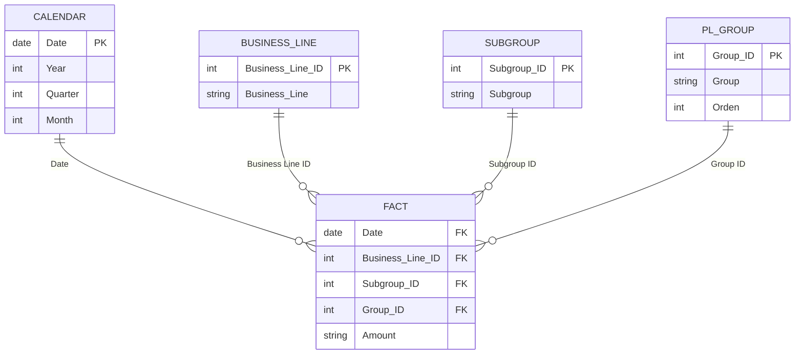

# Financial Performance Dashboard: P&L Analysis 2023

> A 3-page Power BI report that turns 580 monthly P&L entries of a sports company into a CFO-ready view of profit, margins and cost drivers, and shows where 2023 profit was made, lost and put at risk.

**Tools:** Power BI Desktop (Power Query, DAX) · Excel (Design Thinking canvas)


## Table of contents

1. [Objective](#1-objective)
2. [Dataset & data model](#2-dataset--data-model)
3. [Design Thinking process](#3-design-thinking-process)
4. [Key insights & visualizations](#4-key-insights--visualizations)
5. [Final conclusion & recommendations](#5-final-conclusion--recommendations)
6. [Repository structure](#6-repository-structure)

---

## 1. Objective

### What is this project about?

This project analyses the 2023 profit and loss (P&L) statement of a sports company with three business lines: **Sportswear**, **Sports equipment** and **Nutrition & Food Supplements**. The Power BI report follows the P&L from top to bottom (Revenue → COGS → Gross profit → Opex → EBIT → Interest & tax → Net profit), month by month and business line by business line, then drills into the cost lines behind the margins.

### Who is this project for?

| Stakeholder | What they need from the report |
|---|---|
| **CFO / Finance Director** (primary) | One view of profitability, margin trend and cost drivers to set the 2024 budget and cost targets |
| CEO / Board | Which business line to grow, fix or exit |
| Business-line heads | Their own revenue, margins and costs, compared with the other lines |
| FP&A / cost controllers | Monthly variance review and the cost Pareto |

### Business questions

1. How profitable was the company in 2023, and how much of each revenue dollar goes to COGS, Opex and interest & tax?
2. How did revenue, margins and net profit move month by month? Which months under-performed, and why?
3. Which business line creates value, and which destroys it?
4. Which cost lines drive most of the spending, and do they move with revenue or stay fixed?
5. How exposed is profit to a fall in sales?
6. What should management change in 2024: portfolio, cost base, pricing or reporting?

### Project outcome

- **A 3-page interactive report:** *Overview* (company P&L), *Line* (business-line comparison) and *Cost* (cost structure). It has page navigation, a date-range slicer and a business-line filter.
- **A DAX measure layer:** totals for each P&L line, gross profit, EBIT, net profit, GP / EBIT / NP margin, MoM %, Pareto cumulative %, profit YTD, and colour/icon measures for conditional formatting.
- **Answers to the business questions** (details in [section 4](#4-key-insights--visualizations)):
  - 2023 revenue was **\$17.56M** and net profit **\$4.31M**, a 24.6% net margin.
  - **Sportswear** earned **\$2.74M** (63% of group net profit) from 39% of revenue.
  - **Nutrition & Food Supplements lost \$0.71M** after the costs charged to it, although it covers its direct costs.
  - About **72%** of COGS + Opex behaves as fixed or step-fixed. Each \$1 of revenue lost in a month cost about **\$0.64–0.73** of net profit.
- **A Design Thinking canvas** ([Excel file](Design_Thinking_Financial_Dashboard.xlsx)) covering the stakeholders, empathy map, page purposes and metric layers.

---

## 2. Dataset & data model

| Table | Rows | Content |
|---|---:|---|
| `Fact` | 580 | Monthly P&L entries: month-end date, business line, sub-account (Subgroup), P&L group and amount (stored as text, e.g. `$6000`, `($180000)`) |
| `Business_Line` | 3 | Sportswear · Sports equipment · Nutrition and Food Supplements |
| `Group` | 4 | Revenue · COGS · Opex · Interest and tax, with a P&L sort order (`Orden`) |
| `Subgroup` | 15 | Sub-accounts, e.g. Sales Revenue, Consulting, Labor, Materials, Payroll, Rent, R&D |
| `Calendar` | 365 | Daily dates for 2023 (year, quarter, month, week) |



### Data notes

I found these while reconciling every dashboard number with the raw CSVs.

1. **Amounts are text.** `Amount, $` holds values such as `$6000` and `($180000)`. Costs in parentheses become negative numbers, so every P&L line is a plain sum.
2. **One sub-account sits in two P&L groups.** In the `Subgroup` table, sub-account *Other* (ID 9) belongs to **Opex**. In the fact table, 36 of its 72 rows are tagged **COGS** (\$263.7K). The P&L follows the fact table's Group ID, which gives COGS of \$6.71M. The COGS Pareto on the *Cost* page leaves this line out, so it shows Labor at 69.7% of COGS instead of 66.9%.
3. **Two entries look like an extra zero.**
   - Sports-equipment *Shipping* in January is **\$130,000**; every other month is \$9K–\$15K.
   - Nutrition *Consulting* in August is **\$90,000**; every other month is \$9K–\$27K, and \$9,000 appears three times.

   A simple rule, "flag any entry above 3× its line's monthly median", catches exactly these two and nothing else.
4. **Possible duplicate rows.** Sports equipment has two *Other income* rows in each month from January to April and one row afterwards. These 4 extra rows are why the table has 580 rows, not 576. If one row of each pair is a duplicate, H1 revenue and profit are overstated by \$79.5K–\$114K.
5. **Grain.** The fact table holds month-end dates and the calendar is daily, so all trends are monthly.

The dashboard and this README use the data **as recorded**. The table below shows what changes if both suspect entries in note 3 are typos.

| Metric | As recorded | If both entries are typos |
|---|---:|---:|
| 2023 net profit (margin) | \$4.31M (24.6%) | \$4.35M (24.9%) |
| Nutrition net profit · loss months | −\$0.71M · 11 of 12 | −\$0.79M · 12 of 12 |
| Net profit per \$1 of monthly revenue (linear fit) | \$0.64 | \$0.73 |
| Estimated monthly break-even revenue | ≈ \$0.91M | ≈ \$0.96M |
| H2 vs H1 net profit | −36% | −42% |
| Nutrition loss, H2 vs H1 | 33% smaller | 14% smaller |

---

## 3. Design Thinking process

The report was planned with the Design Thinking canvas in [`Design_Thinking_Financial_Dashboard.xlsx`](Design_Thinking_Financial_Dashboard.xlsx). The order was: understand the stakeholder first, then decide what each page must answer and which metrics belong on it.

### 3.1 Empathize: 5W1H

| | Question | Answer |
|---|---|---|
| **Who** | Who will use the dashboard? | **Primary:** CFO / Finance Director, who owns the P&L and the 2024 budget.<br>**Secondary:** the CEO / Board (which business line to grow, fix or exit), the heads of the three business lines (own revenue and cost targets) and FP&A / cost controllers (monthly variance review). |
| **What** | What problem does it solve? | The 2023 P&L is a long table: 580 monthly entries across 3 business lines and 15 sub-accounts. From it, management cannot quickly see where each revenue dollar goes, which business line makes or loses money (and in which month), or which cost lines drive the margin and whether they move with sales. The dashboard turns this into one P&L story: KPIs → waterfall → monthly trend → business lines → cost drivers. |
| **When / Where** | When and where is it used? | **When:** the monthly business review right after month-end close, the quarterly review, the 2024 budget cycle, and ad hoc when a month misses plan (e.g. September 2023).<br>**Where:** Power BI Service, on a laptop or the meeting-room screen. It has 3 pages with navigation buttons, date and business-line filters. |
| **Why** | Why is the analysis needed? | The 2023 totals look healthy (\$17.56M revenue, \$4.31M net profit, 24.6% net margin), but they hide three things: a business line that lost \$0.71M, a net margin that swung from 35.6% (Jan) to 8.2% (Sep), and costs that barely fall when sales fall. Leadership needs evidence to set 2024 budgets and cost targets and to decide the future of each business line. |
| **How** | How does the stakeholder decide? | Top-down, in page order:<br>**1. Overview: are we on track?** KPI cards vs last month, P&L waterfall, revenue vs net margin.<br>**2. Line: where is the problem?** Revenue, profit and margins by business line.<br>**3. Cost: why?** The few cost lines behind most spending, and whether COGS and Opex follow revenue.<br>**Then act:** reallocate budget, set cost targets, adjust price or mix, or restructure a business line. |

### 3.2 Empathy map: CFO persona

| Thinks & feels | Sees | Says & does |
|---|---|---|
| "Total profit looks fine, but is it sustainable?"<br>Suspects one business line is eating the profit the others make.<br>Uneasy about volatility: monthly net margin ranged from 8% to 36%.<br>Under pressure to defend the 2024 budget with facts. | A monthly P&L spreadsheet with 580 rows, 3 business lines and 15 sub-accounts.<br>Big totals (\$17.56M revenue, \$4.31M net profit) with no split by business line.<br>MoM % that jump around (net profit −66% in Sep, +222% in Oct).<br>Sub-account "Other" booked under both COGS and Opex. | **Says:** "Why did September profit collapse?" "Should we keep funding Nutrition?" "Which costs can we actually cut?"<br>**Does:** asks finance for ad hoc Excel cuts every month and compares months and cost lines by hand. |

| Pains | Gains |
|---|---|
| Slow manual consolidation: answers arrive days after the question.<br>No profit view by business line, so a loss-making line hides in the total.<br>Cannot separate structural problems (a fixed cost base) from one-offs (e.g. a \$90K consulting entry in August).<br>MoM % on small bases exaggerate swings.<br>Doubts about data quality: a mis-mapped sub-account and possible typos. | A one-page P&L health check in under a minute.<br>An at-a-glance view of which business line creates or destroys value.<br>A Pareto of the few cost lines behind most spending, which gives focused cost targets.<br>Knowing how much profit is at risk when sales drop (fixed vs variable costs).<br>One set of definitions (GP, EBIT, NP margin) for budget discussions. |

### 3.3 Define & ideate: one job per page

| Page | What it shows | Why it exists |
|---|---|---|
| **Overview** | 5 KPI cards (Revenue, GP margin, EBIT margin, NP margin, Net profit) with MoM and a trend line.<br>A P&L waterfall.<br>Revenue and net margin by month.<br>Revenue by business line.<br>MoM trends of revenue, COGS, Opex and net profit.<br>A monthly P&L detail table. | Answers *"Are we profitable, and where does revenue go?"* on one screen. It is the CFO's starting point before drilling down. |
| **Line** | Revenue, net profit and GP / EBIT / NP margin by business line.<br>Business-line buttons that filter the MoM trend, the COGS and Opex treemaps, and a monthly matrix with colour-coded margins. | Profit is not spread evenly. This page shows which line creates value, which destroys it, and in which month. |
| **Cost** | COGS and Opex Pareto by sub-account (cumulative %).<br>Revenue vs COGS MoM.<br>Revenue vs Opex MoM. | Finds the few cost lines behind most spending and shows whether costs follow revenue or stay flat. This is the basis for cost targets. |

### 3.4 Metric layers

| Layer | Overview | Line | Cost |
|---|---|---|---|
| **Layer 0**: total KPIs | Revenue, GP margin, EBIT margin, NP margin, Net profit, MoM % of each | The same KPIs for each business line | Total COGS, total Opex, MoM % of revenue, COGS and Opex |
| **Layer 1**: split by one dimension | P&L by group (waterfall)<br>Revenue & NP margin by month<br>Revenue by business line<br>MoM by month | Revenue & net profit by business line<br>GP / EBIT / NP margin by business line<br>MoM by month | COGS by sub-account (Pareto)<br>Opex by sub-account (Pareto)<br>Revenue vs COGS / Opex MoM by month |
| **Layer 2**: split by two dimensions | Month × P&L line (detail table) | Sub-account × business line (treemaps)<br>Month × business line (detail matrix) | Sub-account × business line (slicer)<br>Sub-account × month (time slicer) |

### 3.5 Review & iteration

- The P&L waterfall was re-sorted into P&L order (Revenue → COGS → Opex → Interest & tax → Net profit) instead of by size.
- Chart titles were rewritten so each one says what it compares.
- The next iteration is set out in the reporting row of [section 5](#5-final-conclusion--recommendations).

---

## 4. Key insights & visualizations

Each insight has up to four parts:

- **Dashboard:** what the page shown above it displays.
- **Raw data:** what the same CSVs add, computed outside the current pages.
- **Meaning:** what the evidence implies.
- **Industry lens:** general sector knowledge, used as a hypothesis to test, not as proof.

All figures are for 2023, in USD, as recorded (see the sensitivity table in [section 2](#2-dataset--data-model)). "Costs" means COGS + Opex unless stated.

### 4.1 Overview: company P&L


**1. Profitable overall, but Opex is almost as heavy as COGS** · *KPI cards, P&L waterfall*
- **Dashboard:**
  - The P&L runs from revenue of \$17.56M to gross profit of \$10.85M (61.8%), EBIT of \$5.24M (29.9%) and net profit of \$4.31M (24.6%).
  - Of every \$1 of revenue, 38.2¢ goes to COGS, 31.9¢ to Opex and 5.3¢ to interest & tax. The company keeps 24.6¢.
- **Raw data:** Two-thirds of COGS is labour; materials are only 6.1% of revenue.
- **Meaning:** Overheads (people, equipment, rent, marketing) cost almost as much as COGS, and COGS itself is mostly people. Margin work therefore has to target the cost base, not just purchasing.
- **Industry lens:** In most businesses that sell physical goods, COGS is the largest cost line. Overheads this large point to the fixed cost base analysed in insight 9.

**2. Profit moves far more than sales (operating leverage)** · *Revenue & NP margin by month, KPI sparklines*
- **Dashboard:**
  - Revenue peaked in January (\$1.95M) and bottomed in September (\$1.12M), a 1.7× range.
  - Net profit fell from \$694.5K to \$91.6K, a 7.6× range, and NP margin from 35.6% to 8.2%. The NP-margin line follows the revenue bars closely (r = 0.92).
  - In December revenue rose 35% MoM and net profit rose 153%.
- **Raw data:** Between January and September revenue fell \$828K, while costs, interest and tax together fell only \$225K. So 73% of the lost revenue came straight out of net profit (87% if the suspect January shipping entry is a typo).
- **Meaning:**
  - Across 2023's months, net profit moved by about **\$0.64–0.73 for every \$1 of revenue** (linear fit as recorded / with the suspect entries corrected; r ≈ 0.97–0.98).
  - The fit puts monthly break-even near **\$0.9–0.96M** of revenue. No month came close, so that figure is an extrapolation.
  - Even in September, the weakest month, revenue could only have fallen another ~15–19% before the company made a loss.
- **Industry lens:** High operating leverage is typical of firms that carry their own staff, equipment and leases. It rewards growth and punishes slow months.

**3. Product sales are seasonal, but the H2 slowdown came mostly from consulting** · *Revenue & NP margin by month, P&L detail*
- **Dashboard:**
  - H2 revenue was 13.3% below H1 (\$8.16M vs \$9.40M), but H2 net profit was 35.9% lower (\$1.68M vs \$2.63M).
  - Q3 was the weakest quarter, with a 17.0% NP margin against 30.6% in Q1.
- **Raw data:**
  - Product sales fell only 6.5% from H1 to H2.
  - Consulting fell 38.7% and other income 20.1%. Together they account for 63% of the H2 revenue fall.
  - Product sales peak in December, January and May–June, and dip in April and September. January's total-revenue peak is mostly consulting: product sales were the same in December.
  - Fixed costs rose 4% (+\$179K) in H2 instead of falling. At H1's fixed-cost level, H2 net profit would have fallen 29%, not 36%.
- **Meaning:** The H2 profit drop came from lumpy consulting revenue and creeping fixed costs, not from a seasonal dip in core sales. One year of data cannot separate seasonality from trend, so 2021–2022 actuals are needed before budgeting on this pattern.
- **Industry lens:** The product-sales peaks are consistent with (not proof of) the usual sporting-goods drivers: New-Year fitness resolutions, the start of the outdoor season and holiday gifting.

**4. September: revenue fell, COGS did not** · *Revenue / COGS / Opex / Net profit MoM, P&L detail*
- **Dashboard:**
  - In September revenue fell 14.1% MoM but COGS fell only 2.0%. COGS rose to 47.8% of revenue (41.9% in August) and NP margin dropped to 8.2%.
  - The MoM chart does not show this level change. The GP-margin column on the Line page does: 52.2% in September (red) vs 58.1% in August.
- **Raw data:** Net profit fell \$177K from August:
  - Sports equipment: −\$143K (insight 6).
  - Nutrition: −\$63K, more than explained by the reversal of the suspect \$90K August entry. If that entry is \$9K, Nutrition improved by \$18K and the company's fall is \$96K.
  - Sportswear: +\$29K, offsetting part of the fall.
- **Meaning:**
  - The real September problem is Sports equipment. Nutrition's apparent drop is mostly a data issue.
  - October's "+222%" net-profit MoM only brought profit back to about August's level (\$295K vs \$269K). Large MoM % on a small base overstate a recovery.

### 4.2 Line: business-line comparison


**5. Sportswear is the profit engine** · *Revenue & net profit by business line, margins by business line*
- **Dashboard:**
  - Sportswear brings 38.8% of revenue and \$2.74M of net profit. That is 63.4% of group profit, or 54% of the profit made by the two profitable lines.
  - It has the best margin at every level: GP 70.3%, EBIT 45.7%, NP 40.2%.
  - It was profitable in every month, with NP margin between 29.0% and 50.8%.
- **Raw data:** Other income equals 7.8% of Sportswear's revenue. Without it, its NP margin is 35.1%, against 22.4% for Sports equipment.
- **Meaning:** Each \$1 of Sportswear revenue kept 40¢ as net profit, against 26¢ for Sports equipment. If extra Sportswear sales keep similar margins, growth money should go there first.
- **Industry lens:** Apparel often earns higher gross margins than hard goods because brands carry a price premium. Here the gap with Sports equipment is mainly labour, not freight (insight 6).

**6. Sports equipment is the largest line, held back by labour and selling costs** · *margins by business line, COGS treemap, detail matrix (select "Sports equipment")*
- **Dashboard:**
  - Sports equipment brings 50.7% of revenue, but its gross margin is 11.6 pp below Sportswear (58.8% vs 70.3%).
  - In September its GP margin falls to its lowest point of the year.
- **Raw data:**
  - In share of revenue, the gross-margin gap comes from:
    - Labor: +6.9 pp
    - The COGS line "Sales": +2.4 pp
    - Shipping: +1.8 pp, of which ~1.3 pp is the single suspect January entry
    - Materials take the same share in both lines (≈5.2%).
  - Its monthly fixed costs rose 20% during the year, from \$322K in January to \$388K in December: rent doubled, equipment +33%, payroll +17%, labor +11%.
  - H2 revenue fell 14% vs H1, while H2 net profit fell 41%.
  - In September its product sales fell 27% MoM. EBIT was break-even (−\$0.1K), and the line made a \$15.1K net loss after interest & tax.
- **Meaning:**
  - The gap lies in labour and the cost of selling, not in materials, so the levers are operational: staffing and sales incentives. Part of the gap may simply be what equipment costs to handle; only an internal review can say how much.
  - The fixed-cost increases turned a weak month into a loss. At January's fixed-cost base, September EBIT would have been about +\$62K.
- **Industry lens:** Equipment is bulky and is often sold to gyms, schools and clubs, which can involve commissions, delivery and installation labour. These are hypotheses to check before acting.

**7. Nutrition & Food Supplements covers its direct costs but not the costs charged to it** · *revenue & net profit by business line, margins, Opex treemap (select "Nutrition")*
- **Dashboard:**
  - Nutrition earned \$1.84M of revenue (10.5%) at a 44.8% gross margin.
  - EBIT was −\$0.57M (−30.9%) and net profit −\$0.71M (−38.7%).
- **Raw data:**
  - It lost money in 11 of 12 months, or 12 of 12 if the suspect August entry is \$9K.
  - Opex equals 75.7% of its revenue, against 28.4% for Sports equipment and 24.6% for Sportswear. The main lines, as a share of its revenue, are Payroll 24.3%, R&D 19.5% and Marketing 14.4%.
  - Step by step, from gross profit to net profit:

    | Step | Result | If the August entry is \$9K |
    |---|---:|---:|
    | Gross profit | \$0.83M | \$0.75M |
    | After payroll, marketing and other Opex | **+\$0.10M** | +\$0.02M |
    | After R&D (\$0.36M, flat \$30K a month; two-thirds of group R&D) | −\$0.26M | −\$0.34M |
    | After equipment & rent (\$0.31M) → EBIT | −\$0.57M | −\$0.65M |
    | After a flat \$12K-a-month interest & tax charge → net profit | −\$0.71M | −\$0.79M |

  - Equipment is split across the three lines in the same fixed proportion every month, which points to a shared pool rather than Nutrition's own equipment.
  - Labour was cut 23% from July and payroll 20% from September. Gross margin rose from 40.0% (H1) to 44.9% (H2; 49.8% as recorded), but H2 revenue fell 10% (−1.7% as recorded). The loss narrowed only 14% (33% as recorded).
- **Meaning:**
  - The loss comes from R&D and from charges that look allocated, not from day-to-day trading. The decision therefore turns on two facts the P&L does not show: when the R&D is expected to pay off, and which equipment, rent and interest costs would disappear if the line closed.
  - Exiting adds **at most** \$0.71M to group profit. It could even cut profit by about \$0.10M if all those costs are shared.
  - Keeping it needs a plan. To break even at EBIT with Opex held flat, Nutrition needs 38–69% more revenue (45–87% if the August entry is \$9K), or 41% less Opex (47%). The H2 cuts did not close the gap.
- **Industry lens:** Supplement brands front-load R&D (formulation, testing, regulatory work) and brand-building marketing. That is acceptable in a build phase only if revenue then scales, and here it does not.

### 4.3 Cost: cost structure


**8. People are the cost base: Labor + Payroll = 51% of all costs** · *COGS and Opex Pareto*
- **Dashboard:**
  - Labor is the largest COGS line by far. The Pareto shows 69.7%, but that leaves out the \$0.26M "Other" COGS line; the true share is 66.9% of \$6.71M.
  - In Opex, Payroll is the biggest line (31.9%), followed by Equipment (23.8%) and Marketing (18.8%). Together they make up 74.5% of Opex.
- **Raw data:** Labor + Payroll = \$6.28M, which is 35.8% of revenue and 51% of all costs. Materials are only 6.1% of revenue.
- **Meaning:** The 80/20 of cost control is people productivity, equipment use and marketing effectiveness. A 10% saving on materials is worth about \$0.11M, against \$0.45M for a 10% saving on labour.
- **Industry lens:** In supplements and equipment, contract manufacturing is a common way to turn fixed labour into a cost per unit when volumes are small or seasonal.

**9. Most costs barely move with revenue, and labour did not follow demand** · *Revenue vs COGS MoM, Revenue vs Opex MoM*
- **Dashboard:** The MoM lines keep diverging. In March revenue fell 16.2% while COGS rose 1.3%. In February revenue fell 19.6% while Opex rose 0.8%.
- **Raw data:**
  - Costs move only about 28¢ for each \$1 change in monthly revenue (r = 0.87).
  - Labor moves in steps, not with sales (correlation with revenue r = 0.20):

    | Business line | Labor per month during 2023 |
    |---|---|
    | Sports equipment | \$180K → \$234K → \$200K |
    | Sportswear | \$100K → \$130K → \$110K |
    | Nutrition | \$65K → \$50K |

  - Labor, Payroll, Equipment, Rent and R&D are 72% of costs and behave as fixed. That rises to 81% with Materials, which are flat at \$30K a month for Sportswear and \$20K for Nutrition.
  - Fixed costs took 46% of revenue in H1 and 56% in H2. Rent rose 48% and equipment 33% from January to December.
  - The two biggest product-sales months, January and December, ran on base labour: \$3.95 and \$3.79 of product sales per \$1 of labour.
  - Labour was raised 24% for May–June. Those months produced only \$3.02–3.10 per \$1, and the extra labour was released slowly: in August–September labour was still 10% above January–April, and September reached \$2.45. The extra labour cost about \$0.35M from May to December.
- **Meaning:**
  - Only about 16% of costs clearly move with revenue: packaging, shipping, marketing and, partly, the "Sales" line.
  - Profit is therefore protected by capacity decisions, not by costs adjusting on their own. The May labour step-up did not buy more sales than January's base team delivered, unless the May–June mix needed more labour, which the data cannot show.
- **Industry lens:** Seasonal businesses usually flex labour with temporary or contract staff and add fixed commitments (leases, equipment) only with a payback case.

### 4.4 Beyond the dashboard: what the raw data adds

These findings are not visible on the current pages. They come from the same dataset and shape the next iteration.

**10. Consulting makes revenue lumpy.**
- Consulting & professional services bring 16.0% of revenue (\$2.82M) but are the most volatile stream: \$138K–\$495K a month, a 3.6× range against 1.5× for product sales.
- Consulting accounts for 43% of the January-to-September revenue drop and 54% of the H1-to-H2 fall.
- A rough two-variable fit suggests profit reacts more to consulting and other income (~\$0.89 per \$1) than to product sales (~\$0.49). The two streams move together, so treat this as indicative only.
- **Industry lens:** Project-based service revenue is usually lumpy. Retainers and a visible pipeline make it plannable.

**11. "Other income" may inflate operating margins.**
- \$0.97M of "Other income" (5.5% of revenue) is booked as revenue. If it is non-operating, gross margin is 59.6% instead of 61.8%, and EBIT margin is 25.8% instead of 29.9%.
- Sportswear benefits most: other income is 7.8% of its revenue.
- **Industry lens:** Management P&Ls normally show non-operating income below EBIT, so margins describe the core business.

**12. Marketing follows the season, and its return is unproven.**
- Marketing is \$120K in each of the five strongest revenue months (Jan, Feb, May, Jun, Dec; average revenue \$1.73M). It is \$50K–\$65K in March, April and August–October (average revenue \$1.24M). Correlation with revenue: r = 0.89.
- That pattern fits both "marketing drives sales" and "the budget follows sales", so it proves no ROI.
- Nutrition spends 14.4% of its revenue on marketing, against ~5% for the other two lines.
- **Industry lens:** Holdout or geo tests are the standard way to measure incremental return before raising a budget.

---

## 5. Final conclusion & recommendations

**Bottom line:** 2023 was profitable (24.6% net margin), but the profit is fragile:

1. **It rests on two lines.** Sportswear (\$2.74M) and Sports equipment (\$2.29M) carry the group. Nutrition loses \$0.71M after the costs charged to it, although it covers its own direct costs.
2. **Most costs are fixed and some revenue is lumpy.** When consulting fell in H2, a 13% revenue decline cut net profit by 36%.
3. **Fixed costs crept up while product sales slipped.** Fixed costs rose 4% from H1 to H2 (rent +48% and equipment +33% over the year), while product sales fell 6.5%.

The 2024 priorities are:

1. Decide Nutrition's future on a contribution basis.
2. Stop the fixed-cost creep and make labour follow demand.
3. Lift Sports-equipment margins.
4. Make revenue plannable and reporting more transparent.

The table is ordered by profit impact.

| Aspect | Insight | Recommendation |
|---|---|---|
| **Portfolio: Nutrition & Food Supplements** | Lost \$0.71M (\$0.79M if the August entry is \$9K) and lost money in 11 of 12 months. It covers its direct costs (+\$0.10M). The loss comes from R&D (\$0.36M) and from equipment, rent and interest charges (\$0.45M) that look partly allocated. Break-even needs 38–69% more revenue or 41% less Opex. H2 cost cuts narrowed the loss by only 14–33%, and revenue did not grow. | Decide on a contribution basis. List which equipment, rent and interest costs would disappear on exit, and give the R&D a payoff date. Run a 2-quarter turnaround with hard milestones: Opex down to what gross profit can carry (≈42–45% of revenue, against 76–79% now), with R&D and marketing capped as a % of revenue. If the milestones are missed and the costs are avoidable, restructure (narrower range, contract manufacturing) or exit. If most costs are shared, exit gains little and could even cost ~\$0.10M. |
| **Fixed-cost creep & operating leverage** | ~72% of costs behave as fixed (81% with Materials). Net profit moved \$0.64–0.73 per \$1 of monthly revenue. Fixed costs rose 4% in H2 while revenue fell 13%, so they took 56% of revenue against 46% in H1. | Freeze fixed-cost growth. Approve new commitments (rent +48% and equipment +33% in 2023) only with a payback case. Track break-even and margin of safety monthly. |
| **Labour planning** | January and December, the two biggest sales months, ran on base labour (\$3.95 and \$3.79 of product sales per \$1 of labour). The 24% labour increase for May–June produced only \$3.02–3.10 per \$1, was released slowly, and cost ~\$0.35M from May to December. | Cover peaks with temporary or contract labour and release it when the peak ends. Track product sales per \$1 of labour monthly by business line, and require a volume case before any step-up. |
| **Sports equipment margin** | 50.7% of revenue, but gross margin is 11.6 pp below Sportswear (Labor +6.9 pp, "Sales" cost +2.4 pp; materials equal). Fixed costs rose 20% in 2023, H2 net profit fell 41%, and September EBIT was break-even. | Review labour productivity and scheduling. Check what the "Sales" cost line pays for; if it is commissions, tie them to margin rather than volume. Collect item-level margin data to test price and mix options. Freeze further fixed-cost growth until revenue recovers. |
| **Sportswear** | \$2.74M of net profit (63.4% of group; 54% of the profit made by the two profitable lines) from 38.8% of revenue. 40.2% NP margin (35.1% without other income), and no loss month. | Protect and grow it. Give it first call on growth budget and peak-season inventory, scaling spend only where tests show incremental return. Use its ratios as a reference point, adjusted for each line's cost to serve, not as a target for the other lines. |
| **Cost priorities** | Labor + Payroll are 51% of all costs (35.8% of revenue). Labor is two-thirds of COGS. Payroll, Equipment and Marketing are 74.5% of Opex. Materials are only 6.1% of revenue. | Focus the cost programme on labour productivity, equipment use (lease vs own, idle capacity) and marketing effectiveness. Procurement savings on materials have limited upside. |
| **Revenue mix & planning** | Product sales are seasonal (peaks in December, January and May–June; dips in April and September) and fell only 6.5% in H2. Consulting (16% of revenue) fell 39% and drove most of the H2 decline. "Other income" (5.5% of revenue) is booked as revenue. | Budget product sales on the seasonal profile, and budget consulting from a pipeline of retainers. Measure consulting's delivery cost before setting a growth target. Confirm what other income is, and show it below EBIT if it is non-operating (EBIT margin would be 25.8%, not 29.9%). Load 2021–2022 actuals before locking 2024 targets, and re-forecast as months close. |
| **Marketing** | Spend follows revenue (r = 0.89), so ROI is unproven. Nutrition spends 14.4% of its revenue on marketing, against ~5% for the other two lines. | Test trough-month campaigns and Nutrition's marketing with holdout groups before scaling either. Set marketing budgets as a % of revenue for each business line. |
| **Data quality** | Sub-account "Other" is split across COGS and Opex (\$263.7K). Two entries look like an extra zero (\$130K shipping, \$90K consulting). Four Sports-equipment "Other income" rows look duplicated. | Fix the Subgroup mapping with a separate "Other COGS" account. Add a month-end check that flags entries above 3× the line's median (it catches both suspect entries) and duplicate keys. Confirm all of them with accounting. |
| **Reporting (next iteration)** | Margin MoM is shown as relative %: the EBIT margin card's "+80.0%" is really +16.4 pp. MoM % on small bases exaggerate (+222% in October). There is no view of cost ratios, revenue streams, contribution, YoY or budget. | Show margin changes in pp. Add COGS % and Opex % of revenue, revenue by stream, a contribution view by business line, YoY, and budget vs actual. |

---

## 6. Repository structure

```
Financial-Performance-Dashboard/
├── README.md
├── Design_Thinking_Financial_Dashboard.xlsx   # filled Design Thinking canvas
└── images/
    ├── 01_overview.png                        # page 1: company P&L
    ├── 02_business_line.png                   # page 2: business-line comparison
    └── 03_cost.png                            # page 3: cost structure
```
